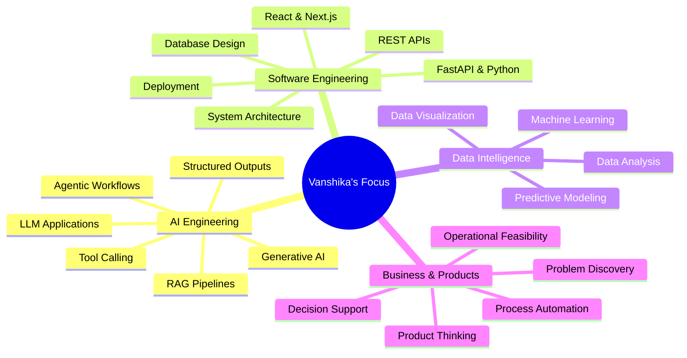

# 👋 Hey! Welcome to my GitHub

<p align="center">
  
</p>

<div align="center">

[](https://www.linkedin.com/in/vanshika-goel-1223b3317)
[](mailto:goelvanshika0204@gmail.com)
[](https://github.com/vanshikagoel02)

</div>

## 🚀 About Me

```python
class VanshikaGoel:

    def __init__(self):
        self.name = "Vanshika Goel"
        self.degree = "B.Tech Computer Engineering"
        self.specialization = "Data Science"

        self.primary_domains = [
            "Generative AI & Agentic Systems",
            "LLM Applications & RAG",
            "AI Engineering & Backend Systems",
            "Full-Stack Application Development",
            "Data Analytics & Decision Intelligence",
            "Business Problem Solving"
        ]

        self.core_stack = {
            "Languages": ["Python", "SQL", "JavaScript"],
            "AI & ML": [
                "Scikit-learn",
                "LLM Integration",
                "Prompt Engineering",
                "RAG & Embeddings"
            ],
            "Backend": [
                "FastAPI",
                "Node.js",
                "Express.js",
                "REST APIs"
            ],
            "Frontend": [
                "React",
                "Next.js",
                "HTML",
                "CSS"
            ],
            "Data & Visualization": [
                "Pandas",
                "Plotly",
                "Power BI",
                "Streamlit"
            ],
            "Databases & Tools": [
                "PostgreSQL",
                "SQLite",
                "Git",
                "GitHub"
            ]
        }

        self.engineering_mindset = (
            "Build useful systems, validate outputs, "
            "measure performance, and solve real problems."
        )

    def what_i_build(self):
        return [
            "🤖 AI-powered applications and intelligent agents",
            "🔗 API-driven systems with structured AI workflows",
            "📊 Analytics dashboards and decision-support tools",
            "⚙️ Full-stack applications for real operational needs",
            "🚀 Practical prototypes that evolve into usable products"
        ]

    def future_direction(self):
        return [
            "Building reliable, tool-using AI agents",
            "Developing production-oriented GenAI applications",
            "Strengthening backend, deployment, and system design",
            "Combining AI engineering with business problem-solving",
            "Creating scalable software products with measurable value"
        ]
```

<div align="center">

### Areas of Interest


</div>

## 🛠️ Tech Stack

<div align="center">


</div>

## 💡 Featured Projects

- **GenAI Competitor Intelligence Agent** — Exploring structured AI workflows for competitor research, analysis, and SWOT generation using LLM integration, API development, and validated outputs.
- **Hotel Dawat POS** — Developing a practical hotel billing and operations system with menu management, table tracking, invoices, and persistent database storage.
- **THE EPOCH** — A real-time, technology-driven investigation and escape-room platform featuring team state management, backend APIs, and event deployment.
- **InsightForge AI** — A data exploration application for dataset uploads, automated summaries, interactive visualizations, and report generation.
- **RouteViz** — A networking-focused project for visualizing packet routing and demonstrating computer networking concepts.
- **MoneyMind / SmartExpense** — An expense-management application featuring income and expense tracking, budgets, transaction history, and financial visualizations.
- **Data Analytics Projects** — Working with datasets to uncover patterns, communicate insights, and support data-driven decisions.

*Explore my repositories for implementation details, technologies, and project progress.*

## 📊 GitHub Analytics

<div align="center">
  
</div>

<div align="center">
  
</div>

<div align="center">
  
</div>

## 🎯 Current Focus Areas



## 🤝 Let's Connect and Collaborate!

I'm interested in building practical AI applications, collaborating on meaningful software projects, and exploring how intelligent systems can solve real-world problems.

**Open for:**

- 🤖 Collaboration on GenAI, agentic AI, and applied ML projects
- 💻 Full-stack development and API-driven application projects
- 📊 Data analytics, visualization, and decision-support solutions
- 🌱 Open-source contributions and technical learning
- 💡 Ideas at the intersection of technology, business, and innovation

<div align="center">

**"Build intelligent systems. Solve real problems. Measure impact. Keep improving."**


⭐️ From [Vanshika Goel](https://github.com/vanshikagoel02)

</div>
